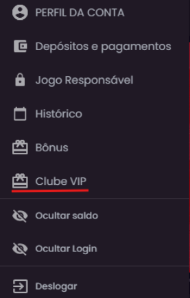
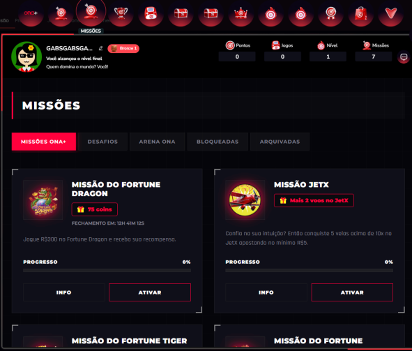
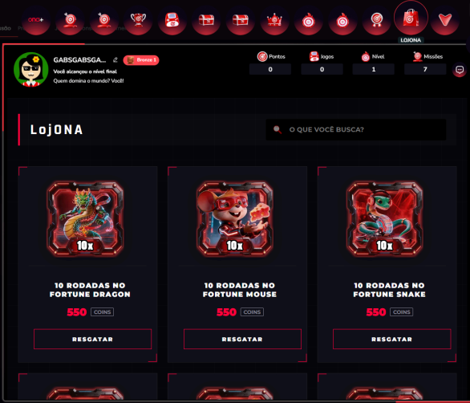
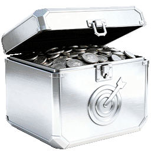

REGULAMENTO DO ONA+
Programa de fidelidade da OnaBet
 
1. APRESENTAÇÃO
   1.1. A Esportes Gaming Brasil LTDA (doravante denominada “Grupo EGB”,
   “Operadora”, “empresa” ou “nós”), é uma pessoa jurídica de direito privado
   devidamente inscrita no CNPJ sob o nº 56.075.466/0001-00, licenciada pela
   Secretaria de Prêmios e Apostas do Ministério da Fazenda (SPA/MF) e detentora
   da marca OnaBet, conforme as Portarias SPA/MF n. 136/2025 e SPA/MF n.
   1.559/2025.
   1.2. O Ona+ é um benefício exclusivo oferecido pela Esportes Gaming Brasil LTDA a
   seus apostadores cadastrados e ativos na plataforma, como forma de
   reconhecimento pela frequência de uso, engajamento e lealdade.
   1.3. A adesão ao Programa é opcional e gratuita, sendo regida por este
   regulamento e alinhada à legislação vigente, incluindo a Lei nº 14.790/2023, a
   Portaria SPA/MF nº 1.231/2024, a legislação consumerista e a Política de Jogo
   Responsável da EGB.
2. GLOSSÁRIO
   2.1. Programa de Fidelidade Ona+ – Programa da Esportes Gaming Brasil LTDA.,
   que concede benefícios progressivos aos apostadores cadastrados e ativos na
   plataforma;
   2.2. Participante – Usuário devidamente cadastrado na plataforma da EGB que
   adere ao Programa de Fidelidade;
   2.3. Coins – Moeda virtual principal do Programa de Fidelidade, que poderá ser
   adquirida pelo usuário;
   2.4. XP – Unidade virtual exclusiva deste Programa de Fidelidade, acumulada pelos
   Participantes em decorrência de cada valor apostado (R$ 10,00 = 10 XP), e que
   contribui diretamente para a evolução do nível do participante;
   2.5. Níveis – Categorias que representam a progressão do Participante no Ona +. São
   120 os níveis progressivos, divididos nas categorias Bronze, Prata, Ouro,
   Esmeralda, Diamante e Black Diamond. Cada nível concede acesso a benefícios
   diferenciados.
   2.6. Benefícios – Vantagens atribuídas aos Participantes do Programa, como Coins,
   Baús, Missões e Torneios exclusivos;
   2.7. Missões – Tarefas ou desafios lançados pela EGB para promover engajamento.
   As missões podem ser básicas, temáticas ou por nível, com recompensas
   vinculadas a sua conclusão.
   2.8. Torneios – Competições organizadas pela EGB entre Participantes, com base
   em critérios objetivos previamente definidos, como volume de apostas ou
   desempenho em mercados selecionados.
   2.9. Loja de Recompensas – Espaço virtual dentro da plataforma em que os
   Participantes podem trocar suas Coins por benefícios determinados, como
   freebets, rodadas grátis, vouchers digitais, entre outros;
   2.10. Tempo de Conta Ativa – Período contínuo em que a conta do Participante
   permanece válida e sem restrições, considerado como critério de engajamento
   para progressão e pontuação no Programa.
   2.11. Política de Jogo Responsável – Conjunto de medidas adotadas pela EGB para
   assegurar que a atividade de apostas seja praticada de forma segura, consciente
   e equilibrada, incluindo ferramentas de autolimitação, bloqueios voluntários e
   autoexclusão.
   2.12. SPA/MF – Secretaria de Prêmios e Apostas do Ministério da Fazenda, órgão
   regulador responsável por disciplinar e fiscalizar a atividade de apostas de quota
   fixa no Brasil.
3. OBJETIVOS
   3.1. O Programa de Fidelidade tem como objetivos:
   3.1.1. Estimular a experiência recreativa e responsável no ambiente de
   apostas;
   3.1.2. Recompensar a atividade legítima de usuários regulares;
   3.1.3. Oferecer incentivos que não dependam de depósitos ou exigências
   desproporcionais; e
   3.1.4. Preservar a conformidade regulatória da EGB.
4. ADESÃO E ACEITE
   4.1. Ao aderir ao programa por meio da opção disponível na Plataforma, o
   participante declara estar ciente e de acordo com este regulamento. A adesão
   não exige qualquer pagamento, depósito ou condição prévia que infrinja a
   legislação e a regulamentação aplicáveis ao setor de apostas de quota fixa.
   4.2. A EGB poderá alterar, suspender ou encerrar o programa, mediante aviso prévio
   com antecedência mínima de 24 horas, sempre resguardando os direitos
   adquiridos dos participantes.
5. Coins
   5.1. Os participantes acumulam Coins, moeda virtual do programa, ao realizarem
   determinadas ações válidas na plataforma (como apostas reais, conclusão de
   missões ou participação em eventos promocionais específicos).
   5.2. Coins não têm valor monetário real, não são transferíveis entre contas ou
   plataformas distintas, não são conversíveis em dinheiro e só podem ser utilizadas
   dentro da respectiva plataforma.
   5.3. Coins poderão ser adquiridos pelos usuários/participantes de duas formas:
   5.3.1. Obtidos por missões exclusivas: Missões especiais que permitem
   que o usuário conquiste Coins como recompensa. Essas Coins
   possuem caráter utilizável na Loja, permitindo que o usuário troque
   por itens diversos (giros extras, saldo real, freespins, etc).
   5.3.2. Obtidos pela evolução do nível do usuário: A cada nível
   conquistado, o usuário tem uma recompensa, dentre elas as Coins.
   5.4. A atribuição de Coins terá como limite máximo 5.000 (cinco mil) Coins por
   semana por conta de Participante, para fins de controle promocional e prevenção
   a abusos, em consonância com a Política de Jogo Responsável praticada pela
   EGB.
   5.5. Para fins de atribuição de Coins, somente serão consideradas apostas
   efetivamente realizadas com saldo real da conta do Participante.
   5.6. Não serão contabilizados para geração de Coins:
   5.6.1. valores oriundos de bônus, freebets, rodadas grátis, créditos
   promocionais ou qualquer outra forma de saldo não proveniente de
   depósito em dinheiro;
   5.6.2. apostas canceladas, invalidadas ou objeto de estorno por qualquer
   motivo;
   5.6.3. valores excedentes que ultrapassem o limite semanal de atribuição
   previsto na Cláusula 5.4.
6. PROGRESSÃO DE NÍVEIS
   6.1. O Programa de Fidelidade Ona++ é composto por seis níveis progressivos:
   Bronze, Prata, Ouro, Esmeralda, Diamante e Black Diamond, atribuídos conforme
   a quantidade de XPs acumulados pelo Participante.
   6.2. A progressão de nível é automática e cumulativa, ocorrendo à medida que o
   Participante acumula XP. O saldo necessário para alcançar cada nível será
   divulgado de forma clara no Painel do Programa, acessível nos sites e
   aplicativos das marcas da EGB.
   6.3. XP expiram caso o usuário esteja inativo a partir de 60 (sessenta) dias;
   6.4. Expirado o prazo previsto no item anterior, os XP serão automaticamente
   cancelados, sem que caiba ao Participante qualquer indenização, conversão em
   valores monetários ou ressarcimento.
   6.5. A expiração dos XPs correrá de forma automática e em ordem cronológica,
   observando-se o princípio “primeiro que entra, primeiro que sai (FIFO - First In,
   First Out)”, de modo a utilizar sempre as moedas mais antigas em primeiro lugar.
   6.6. O controle da validade dos Coins é realizado de forma automática pelo sistema
   da EGB, sendo de responsabilidade do Participante acompanhar a data de
   expiração em seu extrato individual de recompensas.
   6.7. O acúmulo e a utilização dos XPs devem observar a Política de Bônus da EGB,
   os Termos e Condições Gerais da EGB e o presente regulamento.
   6.8. Apostas esportivas e jogos da categoria Cassino ao Vivo não são elegíveis para o
   ganho de XP.
   6.9. Vantagens de cada nível:
   Posição Nível Vantagens
   1 a 20 Bronze Coins, Chaves, Baú Bronze, Missões e
   torneios exclusivos
   21 a 40 Prata Coins, Chaves, Baú Prata, Missões e
   torneios exclusivos
   41 a 60 Ouro Coins, Chaves, Baú Ouro, Missões e
   torneios exclusivos
   61 a 80 Esmeralda Coins, Chaves, Baú Esmeralda,
   Missões e torneios exclusivos
   81 a 100 Diamante Coins, Chaves, Baú Diamante, Missões,
   Torneios e
   Atendimento exclusivo
   101 a 120 Black Diamond Coins, Chaves, Baú Black Diamond,
   Missões, Torneios e Atendimento
   exclusivo
   6.10. A manutenção do nível alcançado no Ona+ está condicionada exclusivamente à
   regularidade da conta do Participante, entendida como:
   6.10.1. manutenção do cadastro ativo e atualizado;
   6.10.2. ausência de bloqueios por autoexclusão, restrição regulatória ou
   suspensões temporárias; e
   6.10.3. cumprimento das normas deste Regulamento, do Programa de Jogo
   Responsável e dos Termos e Condições Gerais da EGB.
   6.11. Não será exigido do Participante qualquer depósito mínimo, volume de apostas,
   aquisição de créditos ou condição semelhante para fins de manutenção de nível,
   vedadas práticas consideradas abusivas.
   6.12. A EGB poderá rebaixar ou suspender o nível do Participante em casos de
   inatividade prolongada, entendida como ausência total de acesso à conta por
   período igual ou superior a 60 dias consecutivos.
   6.13. A EGB reserva-se o direito de realizar ajustes periódicos na tabela de progressão,
   sempre garantindo ampla divulgação prévia e respeitando os princípios de
   transparência, proporcionalidade e não retroatividade.
7. BENEFÍCIOS OFERECIDOS
   7.1. A EGB poderá conceder os seguintes benefícios:
   7.1.1. Freespins (apostas grátis/extras): distribuídas como recompensa
   em missões, torneios ou campanhas especiais, sempre com
   regulamento próprio.
   7.1.2. Coins para resgate em Loja nos termos do “Tópico 10” deste
   Regulamento.
   7.2. Nenhum benefício estará vinculado à exigência de depósito prévio como
   condição de entrada no programa. O uso dos benefícios está sujeito às regras
   específicas de cada campanha ou missão.
8. MISSÕES
   8.1. As missões serão, em sua maioria, com recorrência diária. Ou seja, todos os dias
   às 00h se renovará a possibilidade de cumprimento da missão por parte do
   usuário.
   8.2. No entanto, não existem impedimentos para realização de campanhas com
   durações variáveis, como por exemplo:
   ● Diárias
   ● Semana/Mês
   ● Eventos sazonais
   8.3. Cada uma pode ter regras específicas, como “jogue e ganhe”, “deposite e
   ganhe”, “fique online por x período”;
   8.4. As missões possuem período de duração que sempre constará em sua
   descrição. No entanto, a plataforma se reserva ao direito de suspender sua
   continuidade a qualquer tempo, conforme Termos e Condições (cláusulas 25.3 e
   25.6)
9. Onde encontrar Missões e Loja
   9.1 O usuário encontra a loja acessando a aba no canto superior direito da sua tela,
   clicando em CLUBE VIP conforme captura de tela abaixo:
   
   9.1.1. Acessando o CLUBE VIP, o usuário terá visibilidade de diversas áreas da
   gamificação, como missões, loja, progressão de nível e informações gerais acerca
   do programa de fidelidade Ona+.
   
   
   9.2 Tipos de Baús:
   ● Bronze:
   
   ● Prata:
   
   ● Ouro:
   
   ● Esmeralda:
   
   ● Diamante:
   
   ● Black Diamond:
   
10. CHAVES
    10.1. As Chaves são recompensas concedidas por alguns níveis alcançados.
    10.2. Elas não são compráveis: representam mérito e progressão.
    10.3. Devem ser tratadas como um símbolo de conquista e servirão para abrir os
    Baús
    10.4. Progresso por Era: Cada fase ou "Era" do jogo tem um limite máximo de
    Chaves que podem ser conquistadas de forma justa.
    10.4.1. Limite de Segurança: Para garantir que o jogo continue justo e seguro para
    todos, existe um limite máximo de Chaves por Era/Nível. Nenhuma conta pode
    acumular mais do que esse teto.
    10.4.2. Correções e Auditorias: Nós acompanhamos de perto o funcionamento da
    gamificação. Se o sistema identificar que uma conta possui mais Chaves do que o
    permitido para o seu nível atual, seja por erro do sistema (bug), aproveitamento de
    falhas ou qualquer comportamento irregular, as Chaves em excesso serão
    removidas ou zeradas da conta imediatamente, sem aviso prévio.
    10.2. Não serão consideradas válidas para o ganho ou acúmulo de Chaves:
    ● Pontuações ou níveis alcançados devido a falhas técnicas, instabilidades ou
    erros do sistema;
    ● Ações repetitivas ou artificiais que tentem burlar o ritmo normal do jogo
    apenas para gerar recompensas;
    ● Qualquer quantidade de Chaves que ultrapasse o limite máximo definido
    para a sua Era/Nível atual.
11. BAÚS
    11.1. Os Baús são desbloqueados com o uso das Chaves.
    11.2. Cada Baú contém recompensas que variam conforme o nível do usuário.
    11.3. Os Baús serão encontrados em aba específica no site;
12. LOJA DE RECOMPENSAS
    12.1. A Loja de Recompensas é um benefício opcional da Ona +, permitindo que os
    participantes troquem Coins por itens e vantagens previamente disponibilizados
    na plataforma.
    12.2. Os prêmios e benefícios disponibilizados na Loja poderão incluir:
    12.2.1. Saldo real;
    12.2.2. Freespins;
    12.2.3. Mini-games;
    12.3. Limite de resgate por dia: o usuário poderá resgatar 1 item do mesmo tipo por
    dia.
    12.4. Itens com quantidade limitada: todos os itens estão limitados a um estoque. O
    período de renovação será determinado pela gestão, levando em consideração o
    custo e risco;
    12.5. Vedações:
    12.5.1. É vedada, no âmbito do Ona+ a oferta de prêmios por meio de
    sorteio, concurso ou qualquer modalidade dependente de fator
    aleatório;
    12.5.2. É proibida a exigência de depósito prévio ou volume mínimo de
    apostas para acesso à Loja de Recompensas;
    12.5.3. Não serão ofertados prêmios cujo valor ou natureza possam
    caracterizar promoção comercial sujeita à autorização da Secretaria
    de Prêmios e Apostas (SPA/MF) ou da Secretaria de Reformas
    Econômicas (SEAE/MF), salvo se a EGB obtiver a devida autorização.
    12.6. Estoque e Disponibilidade: Os itens da Loja de Recompensas estão sujeitos à
    disponibilidade e poderão ser alterados, suspensos ou substituídos a qualquer
    momento, com aviso prévio na plataforma.
    12.7. Os produtos na loja atenderão a um estoque e tempo de duração, que poderá ser
    alterado a depender de condições como: patrocínio, contrato com fornecedores,
    custo e calendário promocional.
    12.8. Entrega e Uso dos Itens:
    12.8.1. Itens digitais serão creditados diretamente na conta do Participante
    após a confirmação do resgate;
    12.8.2. Vouchers digitais terão prazo de validade e condições próprias,
    informadas no regulamento da recompensa e no momento do
    resgate.
    12.9. Todos os resgates e transações na Loja de Recompensas estarão sujeitos às
    regras deste Regulamento, à Política de Bônus da EGB, aos Termos e Condições
    de Uso da EGB e à Política de Jogo Responsável.
13. TRANSPARÊNCIA, CONFORMIDADE E GOVERNANÇA DO PROGRAMA
    13.1. A EGB assegura que todas as regras, critérios, benefícios e condições do
    Programa de Fidelidade Ona+ sejam claramente divulgados aos Participantes,
    por meio de canais oficiais da plataforma, em linguagem clara, precisa e
    acessível, em conformidade com o Código de Defesa do Consumidor e demais
    normas aplicáveis.
    13.2. Todos os critérios de pontuação, progressão de níveis, acúmulo e resgate de
    Coins, bem como as condições específicas para usufruto de benefícios, serão
    objetivos, auditáveis e verificáveis pelo próprio Participante, mediante acesso
    a:
    13.2.1. Painel individual de acompanhamento na conta do usuário, contendo
    saldo atualizado de moedas, histórico de transações e resgates, em
    carteira separada da conta gráfica;
    13.2.2. Histórico de participação em missões e campanhas; e
    13.2.3. Indicadores de progresso de nível e próximos benefícios
    desbloqueáveis.
    13.3. Todas as alterações relevantes no regulamento ou nas condições do Programa
    serão comunicadas com antecedência mínima de 24 (vinte e quatro) horas,
    salvo por motivo de caso fortuito, força maior ou determinação legal/regulatória,
    hipóteses em que a comunicação será feita de forma imediata.
    13.4. A EGB manterá registros eletrônicos de todas as operações relacionadas ao
    Programa por prazo mínimo de 5 (cinco) anos, em conformidade com as
    exigências da SPA/MF e com a Política de Privacidade e Proteção de Dados
    Pessoais da EGB.
    13.5. Este Programa de Fidelidade está sujeito a monitoramento constante por parte
    das áreas de Compliance, Auditoria Interna e Jogo Responsável, garantindo que:
    13.5.1. Não haja práticas abusivas ou discriminatórias no acesso ou
    concessão de benefícios;
    13.5.2. Todas as ofertas e incentivos respeitem as diretrizes de prevenção ao
    jogo problemático;
    13.5.3. Benefícios não sejam condicionados a requisitos ilícitos, como
    depósito prévio obrigatório.
    13.6. Sempre que houver ações promocionais vinculadas ao Programa, será elaborado
    Regulamento Específico, contendo as condições particulares da campanha, de
    modo a evitar interpretações ambíguas e assegurar plena conformidade
    regulatória.
    13.7. Suspensão por Movimentação Irregular: Se a plataforma identificar que um
    usuário está jogando de forma artificial, abusiva ou fraudulenta para forçar o
    ganho de recompensas, a participação dele na gamificação poderá ser
    interrompida imediatamente. Isso significa que o acesso às missões, níveis,
    ganho de moedas e uso da loja poderá ser bloqueado temporariamente ou
    permanentemente para essa conta.
14. JOGO RESPONSÁVEL
    14.1. Todos os benefícios, incentivos e recompensas do Programa de Fidelidade Ona+
    estão subordinados às diretrizes do Programa de Jogo Responsável da EGB, que
    integra a estratégia de compliance e sustentabilidade da Operadora.
    14.2. O Programa de Jogo Responsável da EGB contempla, entre outras medidas:
    14.2.1. Ferramentas de autolimitação voluntária, como definição de limites
    de depósito, tempo de sessão, valor de apostas e perdas;
    14.2.2. Mecanismos de autoexclusão temporária ou permanente, disponíveis
    a qualquer usuário que deseje interromper sua atividade;
    14.2.3. Disponibilização de informações educativas em todas as páginas de
    acesso à plataforma e no material promocional, alertando sobre os
    riscos do jogo problemático;
    14.2.4. Canais de apoio e orientação, com links para entidades de referência
    na prevenção e tratamento de jogo patológico;
    14.2.5. Monitoramento preventivo de comportamento irregular, que poderá
    resultar em medidas de bloqueio temporário ou suspensão da conta,
    caso sejam identificados sinais de risco.
    14.3. O Programa de Fidelidade será automaticamente suspenso para usuários com
    restrições ativas decorrentes de bloqueio voluntário, autoexclusão, diagnóstico
    médico de ludopatia, ordem regulatória ou decisão interna da própria EGB,
    conforme disposto nos Termos e Condições Gerais da EGB e para cumprimento
    das diretrizes da Política de Jogo Responsável implementada.
    14.4. A EGB compromete-se a revisar e atualizar periodicamente suas práticas de
    Jogo Responsável, em consonância com as normas da Secretaria de Prêmios e
    Apostas do Ministério da Fazenda (SPA/MF) e com as melhores práticas
    internacionais do setor de entretenimento e apostas.
15. COMUNICAÇÕES
    15.1. A EGB poderá manter os Participantes informados sobre novidades, benefícios e
    funcionalidades do Programa de Fidelidade por meio de canais eletrônicos,
    sempre respeitando as preferências de contato indicadas pelo próprio usuário.
    15.2. A ativação das funcionalidades de comunicação e marketing depende da
    aceitação expressa do Participante, prestada no momento da inscrição no
    Programa de Fidelidade ou posteriormente, mediante gerenciamento de
    preferências em sua conta.
    15.3. As comunicações poderão ser realizadas, de forma não exaustiva, por e-mail,
    SMS, notificações push, mensagens no aplicativo, pop-ups na plataforma ou
    outros canais equivalentes, observadas as escolhas feitas pelo Participante.
    15.4. O conteúdo das mensagens poderá incluir:
    15.4.1. informações institucionais sobre o Programa de Fidelidade, níveis e
    benefícios;
    15.4.2. lembretes acerca de prazos de promoções ou torneios em vigor;
    15.4.3. divulgação de campanhas temporárias com prazo definido; e
    15.4.4. mensagens informativas relacionadas ao progresso do Participante
    em seu nível de fidelidade.
    15.5. O Participante poderá, a qualquer tempo, alterar suas preferências de
    comunicação ou revogar o consentimento concedido, por meio da área de
    gerenciamento de conta.
    Data da última atualização: 27/05/2026
